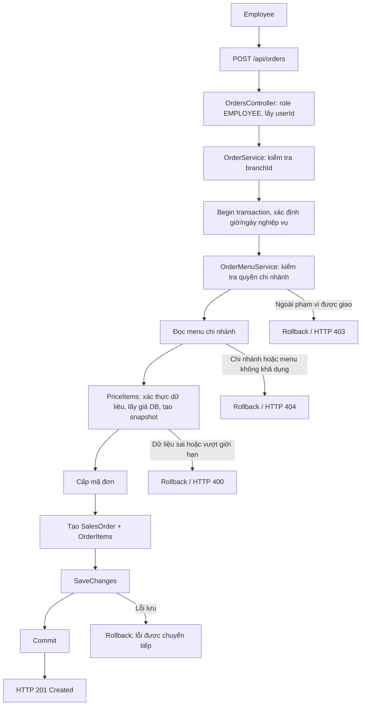

# Tài liệu dẫn luồng tạo đơn — BranchFlow

> **Trạng thái:** Tài liệu chuẩn bị cho người trình bày BT05. Chưa phải biên bản Walkthrough và chưa xác nhận phiên trình bày đã diễn ra.

## 1. Phiên bản và nguồn đối chiếu

- **Mã nguồn:** [TN13007/BranchFlow](https://github.com/TN13007/BranchFlow), nhánh `main`.
- **Candidate mã ứng dụng được kiểm tra:** `05c6b165132809958c69929b95efac900925043b`.
- **Đầu `main` được đối chiếu:** `a7f0115b3fd8ac862bf6bceaa0c6ee6f420d6e76`, ngày 19/11/2026.
- So sánh candidate với đầu `main` cho thấy các commit sau candidate chỉ thay đổi `docs/mvp-scope.md` và bổ sung hồ sơ `tests/final/2026-11-19`; không có tệp mã ứng dụng nào thay đổi. Vì vậy các vị trí mã bên dưới vẫn khớp candidate được kiểm tra.
- **Repository tài liệu (fork/nhánh làm việc):** [TN13007/QA-QC — docs/bt05-walkthrough](https://github.com/TN13007/QA-QC/tree/docs/bt05-walkthrough/bai-tap/walkthrough).
- **Repository chủ nhận Pull Request:** [thuannguyen31241023190-ux/QA-QC](https://github.com/thuannguyen31241023190-ux/QA-QC).
- **Phạm vi nghiệp vụ:** [docs/mvp-scope.md](https://github.com/TN13007/BranchFlow/blob/a7f0115b3fd8ac862bf6bceaa0c6ee6f420d6e76/docs/mvp-scope.md).

Tài liệu tập trung vào luồng Employee tạo đơn: request đi vào API, kiểm tra quyền chi nhánh, tải menu, xác thực dữ liệu, tính giá, cấp mã và lưu giao dịch. Đọc mã nguồn là hoạt động Walkthrough, không thay thế kiểm thử runtime hoặc nghiệm thu.

## 2. Tóm tắt luồng

Employee gửi `POST /api/orders` với chi nhánh, size món, số lượng, topping và lựa chọn ghi chú. API chỉ nhận vai trò `EMPLOYEE`; controller lấy danh tính từ claim `sub`, xác minh quyền tại chi nhánh và lấy menu từ dữ liệu hệ thống. Giá và thông tin snapshot được tính phía server. Mã đơn chỉ được cấp sau khi dữ liệu hợp lệ. Header và các dòng món được lưu trong một transaction; thành công trả về HTTP 201.

## 3. Hợp đồng request và response

### Request

Nguồn: [Contracts.cs, dòng 26–37](https://github.com/TN13007/BranchFlow/blob/05c6b165132809958c69929b95efac900925043b/src/BranchFlow.Application/DTOs/Sprint4/Contracts.cs#L26-L37).

| Thành phần | Trường | Ý nghĩa |
|---|---|---|
| `CreateOrderRequest` | `BranchId` | ID chi nhánh nhân viên muốn tạo đơn |
| `CreateOrderRequest` | `Items` | Danh sách dòng món |
| `CreateOrderItem` | `ProductSizeId` | ID size của sản phẩm trong menu |
| `CreateOrderItem` | `Quantity` | Số ly |
| `CreateOrderItem` | `Toppings` | Danh sách topping được chọn |
| `CreateOrderTopping` | `ToppingId`, `Quantity` | ID topping và số phần trên mỗi ly |
| `CreateOrderItem` | `NoteOptionIds` | Các lựa chọn ghi chú |

Các DTO request có `JsonUnmappedMemberHandling.Disallow`: thuộc tính JSON không nằm trong contract không được chấp nhận. Request không có trường giá; client không quyết định giá món hoặc giá topping.

### Response thành công

Nguồn: `CreatedOrder` trong [Contracts.cs](https://github.com/TN13007/BranchFlow/blob/05c6b165132809958c69929b95efac900925043b/src/BranchFlow.Application/DTOs/Sprint4/Contracts.cs#L35-L37).

Response chứa `Id`, `Code`, `BranchId`, `BusinessDate`, `TotalAmount`, `Status` và `CreatedAt`. Controller trả `Created("/api/orders/{id}", result)`, tương ứng HTTP 201 Created và địa chỉ tài nguyên vừa tạo.

## 4. Lần theo từng bước trong mã nguồn

### Bước 1 — Điểm vào API và xác thực vai trò

[OrdersController.cs, dòng 10–23](https://github.com/TN13007/BranchFlow/blob/05c6b165132809958c69929b95efac900925043b/src/BranchFlow.Api/Controllers/OrdersController.cs#L10-L23).

- Route controller là `api/orders`; action có `[HttpPost]`, nên endpoint tạo đơn là `POST /api/orders`.
- Controller gắn `[Authorize(Roles = "EMPLOYEE")]`. Tài khoản không có quyền Employee không được đi vào action.
- `UserId` lấy từ claim `sub` và chuyển thành số nguyên.
- Action gọi `orders.CreateAsync(UserId, request, ct)`, rồi trả HTTP 201 khi service hoàn tất.

Điểm cần nói rõ: quyền vai trò ở controller và quyền phạm vi chi nhánh ở service là hai lớp kiểm tra khác nhau.

### Bước 2 — Kiểm tra mã chi nhánh và mở transaction

[OrderService.cs, dòng 77–90](https://github.com/TN13007/BranchFlow/blob/05c6b165132809958c69929b95efac900925043b/src/BranchFlow.Application/Services/OrderService.cs#L77-L90).

- `BranchId <= 0` bị từ chối bằng `OrderValidationException` trước khi mở transaction.
- Sau đó service gọi `BeginTransactionAsync`.
- Lấy thời điểm hiện tại từ `TimeProvider.GetUtcNow()`.
- `BusinessDate` được tính bằng cách đổi thời điểm sang UTC+07 rồi lấy ngày. `CreatedAt` lưu thời điểm UTC.

### Bước 3 — Xác minh quyền chi nhánh và lấy menu

[OrderMenuService.cs, dòng 17–41](https://github.com/TN13007/BranchFlow/blob/05c6b165132809958c69929b95efac900925043b/src/BranchFlow.Application/Services/OrderMenuService.cs#L17-L41); lời gọi từ [OrderService.cs, dòng 89–90](https://github.com/TN13007/BranchFlow/blob/05c6b165132809958c69929b95efac900925043b/src/BranchFlow.Application/Services/OrderService.cs#L89-L90).

- `OrderMenuService` kiểm tra `branchId` dương.
- Gọi `HasBranchScopeAsync(userId, branchId)` trước khi truy vấn repository. Nếu không có quyền, ném `UnauthorizedAccessException`.
- Nếu có quyền, service đọc menu chi nhánh; menu không tồn tại trả `null`.
- Menu trả về gồm chi nhánh, danh mục/sản phẩm/size, nhóm topping và nhóm ghi chú. `OrderService` chuyển menu `null` thành `OrderBranchUnavailableException`.

### Bước 4 — Xác thực và tính giá bằng PriceItems

[OrderService.PriceItems, dòng 13–72](https://github.com/TN13007/BranchFlow/blob/05c6b165132809958c69929b95efac900925043b/src/BranchFlow.Application/Services/OrderService.cs#L13-L72).

| Dữ liệu | Quy tắc đang được mã hóa |
|---|---|
| Danh sách món | Có từ 1 đến 100 dòng |
| Số ly | Từ 1 đến 999 cho mỗi dòng |
| Size | `ProductSizeId` phải dương và phải tìm được trong menu của chi nhánh |
| Topping | ID dương, không trùng trong cùng dòng, số phần từ 1 đến 3 và không vượt `MaxQuantity` của topping |
| Ghi chú | ID dương, không trùng; mỗi nhóm chỉ nhận tối đa một lựa chọn trong logic hiện tại |
| Giá | Lấy giá size và topping từ menu trả về bởi server; không dùng giá do client gửi |
| Snapshot | Lưu tên sản phẩm, tên size, tên topping, tên lựa chọn ghi chú và đơn giá tại thời điểm tạo |
| Thành tiền | Giá một ly = giá size + tổng giá topping; thành tiền dòng = giá một ly × số ly |
| Tổng đơn | Cộng có kiểm tra tràn số và giới hạn giá trị tổng |

Các đoạn chính:
- Số dòng, số lượng, size: dòng 15–27.
- Giá size, topping và snapshot: dòng 24–44.
- Ghi chú: dòng 46–55.
- Thành tiền và tổng đơn: dòng 57–72.

### Bước 5 — Chỉ cấp mã sau khi dữ liệu hợp lệ

[OrderService.cs, dòng 91–98](https://github.com/TN13007/BranchFlow/blob/05c6b165132809958c69929b95efac900925043b/src/BranchFlow.Application/Services/OrderService.cs#L91-L98).

Service gọi `PriceItems` trước, sau đó mới gọi `AllocateCodeAsync(branchId, businessDate)`. Nếu branch hoặc dữ liệu đơn không hợp lệ, luồng không đi đến bước cấp mã.

### Bước 6 — Tạo bản ghi, lưu và commit

[OrderService.cs, dòng 99–127](https://github.com/TN13007/BranchFlow/blob/05c6b165132809958c69929b95efac900925043b/src/BranchFlow.Application/Services/OrderService.cs#L99-L127).

- Tạo `SalesOrder` với mã, chi nhánh, người tạo, ngày nghiệp vụ, thời điểm tạo, tổng tiền và danh sách dòng món.
- Mã hiện gán `Status = "COMPLETED"` ngay khi tạo.
- Gọi `orders.Add`, `SaveChangesAsync`, rồi `CommitTransactionAsync`.
- Nếu SQL exception có mã 51001, service rollback và đổi thành `OrderBranchUnavailableException`.
- Với lỗi khác, service rollback rồi ném lại exception để tầng xử lý lỗi bên ngoài tiếp nhận.

## 5. Xử lý lỗi cần trình bày

| Tình huống | Nơi xử lý | Kết quả thấy trong mã |
|---|---|---|
| `BranchId` không dương | `OrderService.CreateAsync` | `OrderValidationException`; controller trả 400 |
| Employee không được phân công tại chi nhánh | `OrderMenuService` | `UnauthorizedAccessException`; controller trả 403; transaction được rollback |
| Chi nhánh/menu không khả dụng | `OrderService` | `OrderBranchUnavailableException`; controller trả 404; transaction được rollback |
| Dòng món, size, số lượng, topping hoặc ghi chú không hợp lệ | `PriceItems` | `OrderValidationException`; controller trả 400; transaction được rollback |
| Giá trị số vượt giới hạn | `PriceItems` hoặc phép toán checked | `OverflowException` hoặc validation exception; controller có nhánh trả 400 |
| Lỗi khi lưu dữ liệu | `OrderService.CreateAsync` | Rollback rồi ném lại lỗi; mã action không định nghĩa status riêng cho mọi exception |

Controller ánh xạ các exception tại [OrdersController.cs, dòng 18–28](https://github.com/TN13007/BranchFlow/blob/05c6b165132809958c69929b95efac900925043b/src/BranchFlow.Api/Controllers/OrdersController.cs#L18-L28). Không tự kết luận status HTTP cho exception không được action bắt; cần đối chiếu middleware cấu hình toàn ứng dụng nếu muốn trình bày chi tiết.

## 6. Các câu hỏi nên đưa ra trong Walkthrough

Đây là câu hỏi để nhóm xác nhận, không phải kết luận lỗi:

1. **Trạng thái ban đầu:** mã hiện gán đơn thành `COMPLETED` ngay khi tạo. Đây có đúng quy tắc nghiệp vụ và cách dùng trạng thái trong MVP không?
2. **Ghi chú:** DTO menu có `MaxSelections`, nhưng logic tạo đơn hiện không cho chọn hai option cùng nhóm. Quy tắc dự kiến là tối đa một lựa chọn hay cần tôn trọng số `MaxSelections`?
3. **Gửi lại request:** contract tạo đơn không có idempotency key và phương thức `CreateAsync` không thể hiện cơ chế nhận diện yêu cầu gửi lại. Khi client timeout sau khi server đã lưu đơn, nhóm mong muốn xử lý thế nào?
4. **Ngày nghiệp vụ:** ngày được tính theo UTC+07 bằng offset cố định. Đây có phải quy tắc chính thức cho toàn bộ cửa hàng/chi nhánh trong phạm vi MVP?
5. **Kho:** MVP nêu nhập/xuất kho thủ công và bán hàng không tự trừ kho. Cần nói rõ rằng tạo đơn không đồng nghĩa cập nhật tồn kho.

Chỉ ghi nhận một điểm là lỗi khi nhóm đối chiếu được yêu cầu đã xác nhận, bằng chứng và hành vi thực tế.

## 7. Test tham chiếu và bằng chứng hiện có

### Unit test liên quan

- [OrderPricingTests.cs](https://github.com/TN13007/BranchFlow/blob/05c6b165132809958c69929b95efac900925043b/tests/BranchFlow.Tests/Backend/OrderPricingTests.cs): kiểm tra tính giá server và snapshot; từ chối số ly không hợp lệ; topping trùng/quá ba phần; ghi chú trùng nhóm và size không tồn tại.
- [OrderServiceTests.cs](https://github.com/TN13007/BranchFlow/blob/05c6b165132809958c69929b95efac900925043b/tests/BranchFlow.Tests/Backend/OrderServiceTests.cs): kiểm tra luồng hợp lệ; branch không được phép; branch không khả dụng; đơn không hợp lệ; lỗi lưu; branch ID không hợp lệ. Test dùng mock và fixed time provider, không phải bằng chứng người dùng đã walkthrough.

Trong fixture của `OrderPricingTests`, một dòng hai ly có giá snapshot size 30.000 đồng và thành tiền dòng 98.000 đồng. Đây là dữ liệu kiểm thử `PreviewMenu`, không phải giá bán đang áp dụng ở cửa hàng hoặc dữ liệu Azure.

### Hồ sơ tích hợp ngày 19/11/2026

[tests/final/2026-11-19/README.md](https://github.com/TN13007/BranchFlow/blob/a7f0115b3fd8ac862bf6bceaa0c6ee6f420d6e76/tests/final/2026-11-19/README.md) ghi nhận build Release thành công và bộ .NET + SQL Server có 128 Passed, 0 Failed, 0 Skipped. Hồ sơ cũng ghi nhận các lượt browser và kiểm tra sau deploy. Đây là kết quả kỹ thuật của các lượt đã ghi trong hồ sơ, không phải kết quả của phiên Walkthrough BT05.

## 8. Kịch bản nói ngắn cho người trình bày

1. **Mở đầu:** “Tôi trình bày riêng luồng Employee tạo đơn từ `POST /api/orders` đến khi API trả kết quả. Phạm vi không bao gồm kiểm thử toàn hệ thống.”
2. **Request:** chỉ ra `BranchId`, `ProductSizeId`, `Quantity`, `Toppings`, `NoteOptionIds`; nhấn mạnh request không mang giá.
3. **Quyền:** chỉ ra `[Authorize(Roles = "EMPLOYEE")]`, sau đó đi vào `HasBranchScopeAsync` để phân biệt quyền vai trò với quyền chi nhánh.
4. **Tính giá:** mở `PriceItems`; đi lần lượt size, topping, ghi chú, snapshot và phép tính thành tiền.
5. **Giao dịch:** chỉ ra vị trí bắt đầu transaction, cấp mã sau validation, lưu và commit; mô tả rollback khi lỗi.
6. **Kết thúc:** nêu HTTP 201, các nhóm lỗi 400/403/404 và đọc lại các câu hỏi cần nhóm xác nhận.

## 9. Tình trạng phiên và phần cần hoàn tất sau buổi họp

| Nội dung | Trạng thái |
|---|---|
| Tài liệu dẫn luồng | Đã chuẩn bị |
| Phiên bản mã và vị trí tham chiếu | Đã đối chiếu đến candidate 19/11 |
| Người trình bày đã trình bày trong phiên thật | Chưa xác nhận |
| Thời gian và người tham dự thực tế | Chưa có |
| Ý kiến được nhóm thống nhất | Chưa có |
| Vấn đề/biên bản và người theo dõi | Chưa có |
| Kết quả xác minh lại sau phiên | Chưa có |

Sau phiên, cập nhật biên bản riêng với ngày giờ thực tế, người tham dự, nội dung được nhóm thống nhất và liên kết minh chứng. Không chuyển các câu hỏi trong tài liệu này thành bug report nếu chưa có kết luận và căn cứ.
